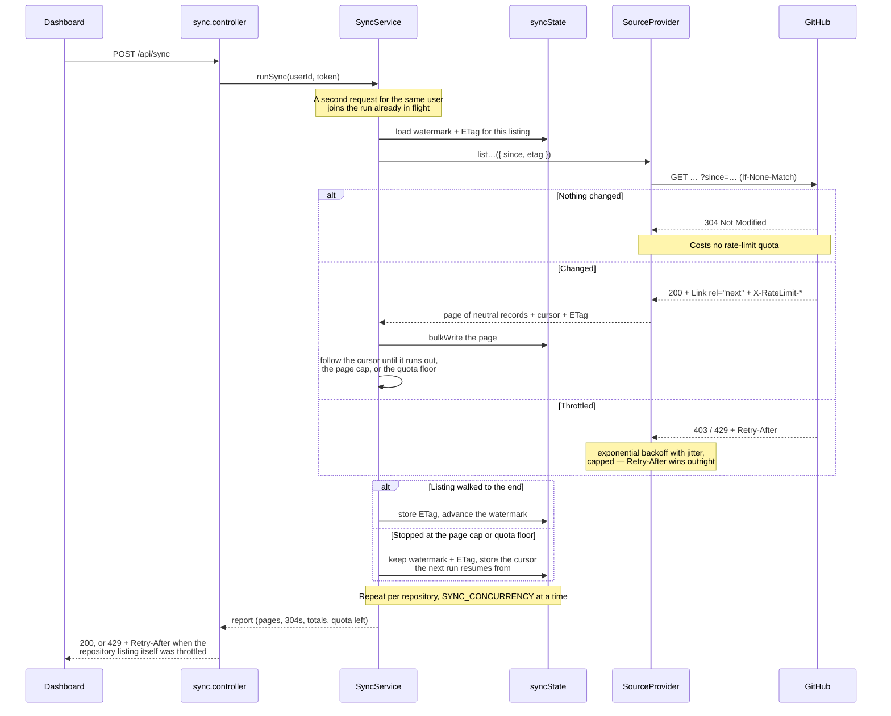
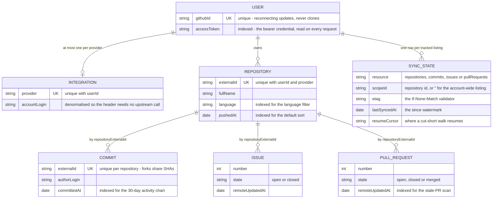
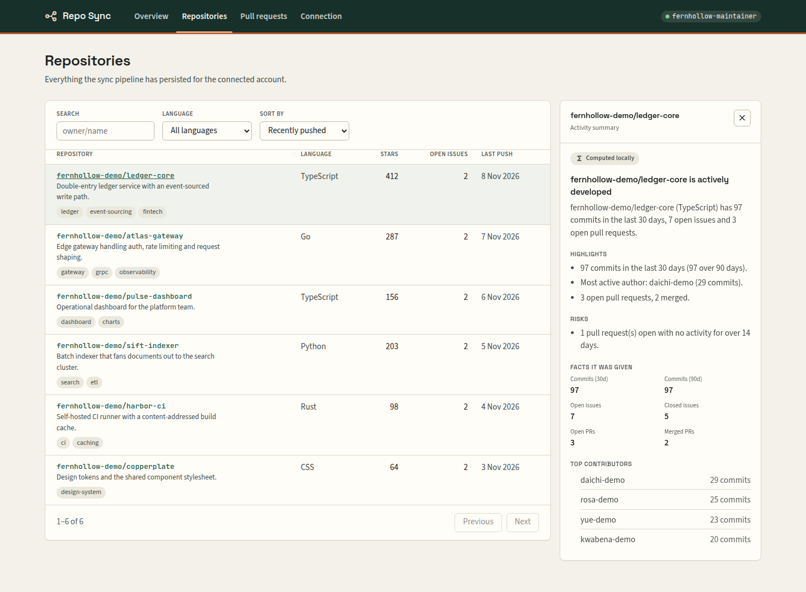
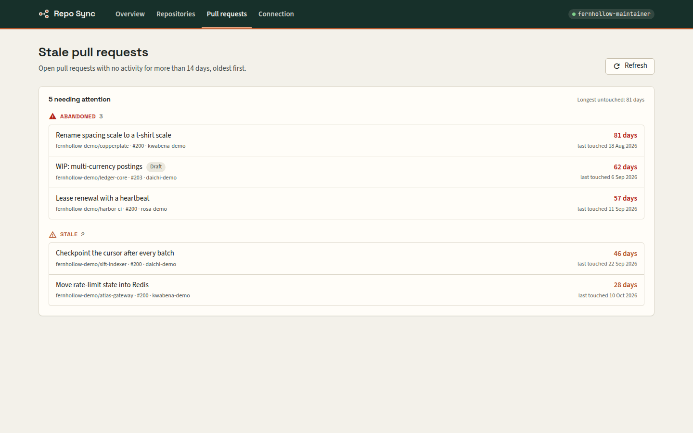
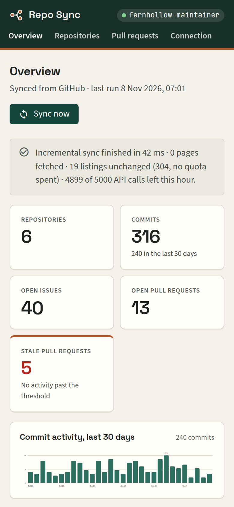
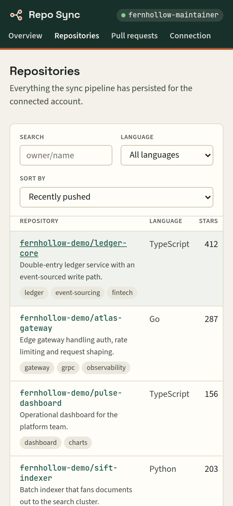
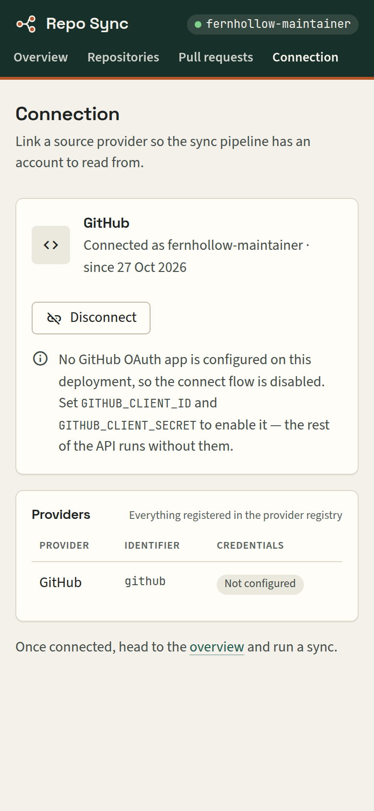

# Repo Sync

Connect a GitHub account over OAuth, pull its repositories, commits, issues and pull
requests into MongoDB, serve them to an Angular dashboard. The CRUD is the easy half; the
half worth reading is the sync pipeline, which exists to keep an account current **without
spending GitHub's hourly rate limit on data that has not changed**. It runs with no GitHub
credentials at all — the API boots, the read endpoints work, and a bundled stand-in for
`api.github.com` lets the whole pipeline be watched offline.

Stack: Node 22, Express 5 and TypeScript with Mongoose 8 for the API (`backend/`), and
Angular 21 served by nginx for the dashboard (`frontend/`).

## 19 pages, then 0

An authenticated token gets 5,000 REST calls an hour, and secondary limits throttle bursts
well before that. A 200-repository account costs roughly 600 calls per run just to re-list
its children, so an hourly sync burns most of its budget re-fetching unchanged records. The
design is about *not making the call*.

The demo stack shows it. Its seeded account has 6 repositories, tracked as **19 listings**:
one account-wide repository listing, plus commits, issues and pull requests for each of
the 6. That is exactly what the dashboard's *Sync pipeline state* panel shows
(6 + 6 + 6 + 1). On the first run every listing is walked:

```console
$ curl -s -X POST -H "Authorization: Bearer demo-token" http://localhost:8231/api/sync
{
  "provider": "github",
  "mode": "incremental",
  "durationMs": 90,
  "totals": { "repositories": 6, "commits": 2, "issues": 48, "pullRequests": 6 },
  "pagesFetched": 19,
  "conditionalHits": 0,
  "rateLimit": { "limit": 5000, "remaining": 4899, "resetAt": 1794124006 },
  "warnings": [],
  "results": [ … one entry per listing … ]
}
```

A second run moments later. Every listing answers `304 Not Modified`, which GitHub does not
charge against the quota, so nothing is fetched at all:

```console
$ curl -s -X POST -H "Authorization: Bearer demo-token" http://localhost:8231/api/sync
{
  "mode": "incremental",
  "durationMs": 37,
  "totals": { "repositories": 0, "commits": 0, "issues": 0, "pullRequests": 0 },
  "pagesFetched": 0,
  "conditionalHits": 19,
  …
}
```

Both are captured from the compose stack against the bundled mock: real HTTP through the
real client, not a simulation. Timings vary; the 19 then 0 does not. (Only 2 commits arrive
on the first run because the seed already stored the rest and the commit listing is asked
only for what changed after its watermark.)

## Not making the call



The mechanisms live in `services/sync.service.ts`, `providers/github/githubClient.ts` and `lib/`:

- **Conditional requests.** Each listing stores the `ETag` of its first page and replays it
  as `If-None-Match` — only on page 0 of a walk, which is the only page it applies to.
- **Per-resource watermarks.** Every resource in every repository keeps its own
  `lastSyncedAt` in `syncState`, replayed as `since`. A failed or rate-limited run does
  *not* advance its watermark, or the records it never fetched would be skipped forever.
  `/pulls` accepts no `since`, so there the provider sorts by `updated` descending, applies
  the watermark client-side, and stops paging at the first page that reaches back past it.
- **Resumable walks.** A listing cut short by `SYNC_MAX_PAGES` or the quota floor is
  recorded as `partial`. It keeps its old watermark and ETag and stores the `rel="next"`
  cursor it stopped at, and the next run carries on from there. Only when the listing has
  been walked to its end does the watermark move, to the start of the first run in that
  chain.
- **Cursor pagination.** Pages are walked by following `Link: rel="next"`. Computed page
  numbers drift when records are inserted mid-walk; the header does not.
- **A quota floor.** Pagination stops once `X-RateLimit-Remaining` falls to
  `SYNC_RATE_LIMIT_FLOOR` (default 50), so a background sync cannot starve an OAuth callback.
- **Backoff that defers to the server.** `429`, and `403` with either an exhausted quota or
  a `Retry-After`, are classified as rate limiting and retried with exponential backoff plus
  jitter, capped at 60s; a `Retry-After` overrides the computed delay.
- **Bounded concurrency and single-flight.** Repositories sync `SYNC_CONCURRENCY` at a time,
  and concurrent requests for one user join the run in flight — a double-clicked "Sync now"
  costs one run's quota, not two.

One failure does not sink the run: a resource that errors records its status and message on
its own `syncState` row, and the walk continues. `GET /api/sync/state` returns those rows —
watermark, last status, *whether* an ETag is held (never its value) and whether a resume is
pending. That is what makes the pipeline debuggable rather than a black box.

## What lands in Mongo



Child records point at their repository by the provider's own `externalId` string, not an
`ObjectId` ref: the sync `bulkWrite`s pages of them before any repository `_id` is in hand,
and that string is the upsert key anyway. On the read side `?limit=` is clamped server-side
to `API_MAX_PAGE_SIZE` (verified: `?limit=500` returns 100), dashboard counts are
aggregations rather than documents loaded and counted in Node, and "commits per top
repository" is one `$lookup` instead of five follow-up counts.

## The screens


*Overview, right after a sync. The banner is the run report; the bottom panel is the
pipeline's own state: 19 tracked listings, all holding a stored ETag, none failing.*



*Repositories: server-side search, filter, sort and paging. The language list covers the
whole account. The summary panel's badge names its source, here **Computed locally**,
because this deployment has no API key.*



*Stale pull requests, graded off `STALE_PR_DAYS`: watch at 1×, stale at 2×, abandoned at 4×.
It is a rule, not a model, so the list can be acted on without trusting one.*

<p>
  
  
  
</p>

All data on these screens is the fabricated demo account (`fernhollow-demo`, authors ending
in `-demo`) synced from the bundled mock.

## Running it

```bash
docker compose up --build
```

That starts MongoDB, seeds a fabricated demo account, runs the API and the web app, and
serves a stand-in for `api.github.com`, so the pipeline has something real to sync from with
no GitHub account and no credentials.

| Service | URL |
| --- | --- |
| Web app | <http://localhost:8230> |
| API | <http://localhost:8231> |
| Mock GitHub API | <http://localhost:8233> |

Open <http://localhost:8230>, go to **Connection**, choose **Open the demo account**, then
press **Sync now**. `GET /health` reports liveness, whether Mongo is actually reachable,
which providers hold credentials, and whether AI is enabled:

```console
$ curl -s http://localhost:8231/health
{"status":"ok","database":"connected","providers":[{"id":"github","configured":false}],"ai":"heuristics-only"}
```

Tear down with `docker compose down -v`.

### Without Docker

Both halves pin Node 22 (`.nvmrc`, `engines`).

```bash
cd backend
cp .env.example .env    # then set DB_URL to a running MongoDB
npm ci
npm run seed            # writes the fabricated demo account
npm run mock-github     # the api.github.com stand-in, on :4100
npm run dev             # ts-node + nodemon on :3000
npm test                # Vitest, 234 tests
npm run lint && npm run format:check

cd ../frontend
npm ci
npm start               # ng serve on :4200, proxying /api to :3000
npm test                # Karma + headless Chrome, 39 specs (set CHROME_BIN if needed)
npm run lint && npm run format:check
npm run build
```

To run the demo this way, set `GITHUB_API_BASE_URL=http://localhost:4100` and
`DEMO_MODE=true` in `backend/.env`.

None of the tests touch the network or a database. Every GitHub call is mocked at the axios
module boundary, the models are in-memory doubles (plus one test that runs the real
`SyncState` schema through `validateSync()`), and the suite runs with `ANTHROPIC_API_KEY`
deleted so no test can make a paid call.

To connect a real account, create an OAuth app with the callback URL
`http://localhost:8231/api/github/callback`. On the `api` service, set `GITHUB_CLIENT_ID`,
`GITHUB_CLIENT_SECRET` and `GITHUB_REDIRECT_URI`, drop the `GITHUB_API_BASE_URL` override so
it talks to `api.github.com`, and turn `DEMO_MODE` off.

## Configuration

Read and validated once at import time, so a misconfigured deployment fails at boot rather
than on the first request. Below is the part worth knowing; `backend/.env.example` carries
the full list — scopes, timeouts, retry tuning, page caps, model name, log level — with
placeholder values throughout.

| Variable | Required | Default | What it does |
| --- | --- | --- | --- |
| `DB_URL` | yes | — | MongoDB connection string. |
| `SERVER_PORT` | yes | — | Port the API listens on; boot fails if unset. |
| `FRONTEND_URL` | no | `http://localhost:4200` | Where the OAuth callback sends the browser back to; also the default `CORS_ORIGINS`. |
| `GITHUB_CLIENT_ID` / `_SECRET` | no | *(empty)* | OAuth app credentials. Without them the connect flow answers 503; everything else still runs. |
| `GITHUB_API_BASE_URL` | no | `https://api.github.com` | REST API root. Point it at the mock to run offline. |
| `SYNC_CONCURRENCY` | no | `4` | Repositories whose children sync in parallel. |
| `SYNC_MAX_PAGES` | no | `20` | Pages walked per listing per run; a longer listing resumes on the next run. |
| `SYNC_RATE_LIMIT_FLOOR` | no | `50` | Stop paginating at this much remaining quota. |
| `API_MAX_PAGE_SIZE` | no | `100` | Server-side cap on `?limit=`. |
| `STALE_PR_DAYS` | no | `14` | Inactivity before an open pull request is reported stale. |
| `ANTHROPIC_API_KEY` | no | *(empty)* | Enables model-written summaries. Without it they are computed locally. |
| `DEMO_MODE` | no | `false` | Exposes `GET /api/demo/session`, handing out the seeded account's token. Demo only — an authentication bypass, and it logs a warning at boot. |

The frontend needs no environment variables: it calls `/api` on its own origin, proxied by
`ng serve` in development and by nginx in the container.

## Bugs that left evidence

Each of these was fixed with a test that fails on the old code.

- **`SyncState.scopeId` was `{ required: true, default: '' }`.** Mongoose's `required`
  validator rejects the empty string, and the empty string is exactly the scope the
  account-wide repository listing uses. Every repository sync failed validation before it
  could store its resume point. `test/models/syncState.model.test.ts` runs the real schema.
- **There was no OAuth `state` parameter.** That is the CSRF hole that lets an attacker bind
  a victim's session to their own GitHub account. `src/helpers/oauthState.ts` issues an
  unguessable, single-use value per attempt and consumes it in the callback. An unknown,
  expired or replayed value is a `400`, and the code is never exchanged. The store is
  in-memory by design; a multi-instance deployment needs a shared one.
- **The token came back in the query string.** The callback now hands it to the SPA in the
  URL fragment (`/connection#token=…`), which browsers never send to a server, so it stays
  out of access logs and `Referer` headers.
- **A walk cut short by the page cap still advanced its watermark**, so the pages it never
  reached fell outside the next run's `since` for good. Walks are now resumable (above).
- **The language filter only offered languages from the current page.** Picking one hid the
  rest. `GET /api/catalog/languages` now serves the whole account's list.

Nearby: the logger redacts any context key matching `token`, `secret`, `password`,
`authorization` or `api key`; unexpected errors are logged in full and answered with a bare
`500`; a `401` for a stored token signs the SPA out; and every credential in
`backend/.env.example` is an obvious placeholder.

## The one seam

`SourceProvider` in `src/domain/provider.ts`, with the registry in `src/domain/registry.ts`,
is the only abstraction here, and it is the one a second source actually needs: authorisation
URL, token exchange, account identity, revocation, and the four paginated listings, all in
provider-neutral record types — so nothing above it ever sees a GitHub payload shape.

It is verifiably real rather than aspirational: `SyncService` is constructed with a
`SourceProvider`, imports nothing from `providers/github`, and its 27 tests drive it with a
hand-written fake. Adding GitLab is one class plus one line in `src/providers/index.ts`.

## AI, where it earns its place

Repository summaries compute their facts locally — commit cadence over 30 and 90 days, top
contributors, issue and PR counts, stale PRs, recent commit subjects — and ask Claude only
to turn those facts into prose, with `output_config.format` constraining the reply to a
JSON schema. With no API key, on a failure, or on a refusal, a deterministic narrative
built from the *same* facts is returned instead; the response's `source` field says `model`
or `heuristic` and the UI renders it as a badge, so a reader is never guessing. Summaries
are cached per user and repository for ten minutes. Stale-PR detection is deliberately not
a model: "open and untouched for N days" is explainable, free, and works with no key.

## What this does not do

- **No webhooks.** Sync is pull-only and must be triggered — by the dashboard or a
  `POST /api/sync`. There is no `push`/`pull_request` webhook endpoint, so the data is only
  as fresh as the last run.
- **No scheduler.** Nothing runs the sync on a timer. For a fleet of accounts the run
  belongs in a queue worker rather than an HTTP request.
- **No GraphQL.** Everything uses REST; GraphQL would fetch some of these shapes in far
  fewer calls.
- **Sessions are bare bearer tokens.** The GitHub access token *is* the API credential: no
  separate session layer, no refresh, no expiry handling, stored unencrypted at rest and in
  the browser's `localStorage`.
- **One integration per user per provider.** The schema does not model an organisation with
  several linked accounts.
- **Offset paging on reads.** `page`/`limit` with `skip` is fine at these sizes but degrades
  deep into a large collection; keyset paging is the next step.
- **Only GitHub is implemented.** The provider seam exists and is tested; GitLab and
  Bitbucket providers are not written.
- **The insight cache is in-process.** It does not survive a restart or reach other instances.

## Licence

MIT. See [LICENSE](LICENSE).
