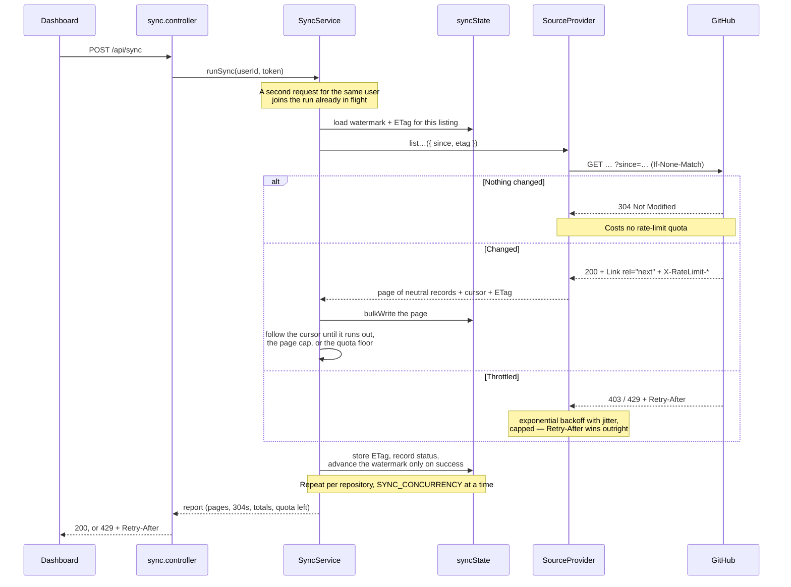
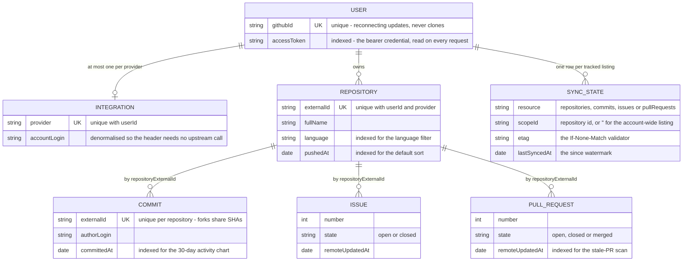
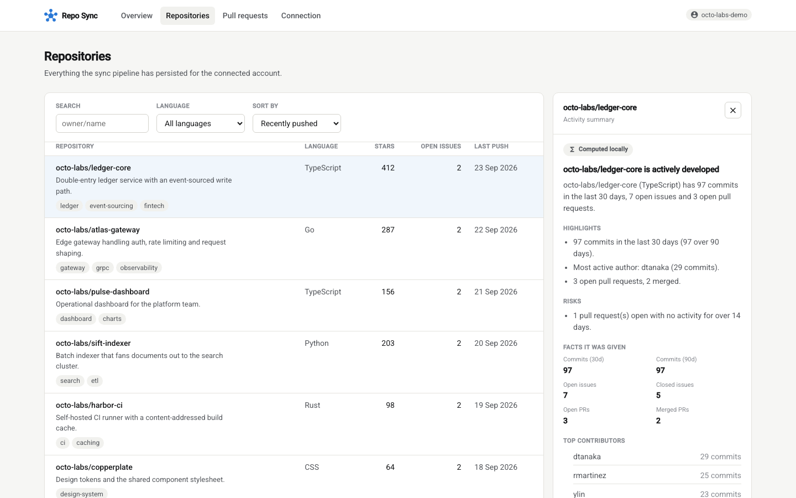
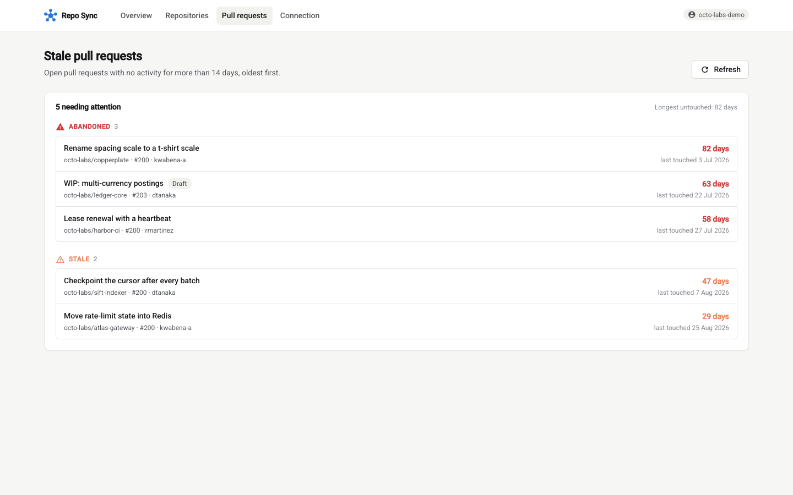

# Repo Sync

Connect a GitHub account over OAuth, pull its repositories, commits, issues and pull
requests into MongoDB, serve them to an Angular dashboard. The CRUD is the easy half; the
half worth reading is the sync pipeline, which exists to keep an account current **without
spending GitHub's hourly rate limit on data that has not changed**. It runs with no GitHub
credentials at all — the API boots, the read endpoints work, and a bundled stand-in for
`api.github.com` lets the whole pipeline be watched offline.

## 19 pages, then 0

An authenticated token gets 5,000 REST calls an hour, and secondary limits throttle bursts
well before that. A 200-repository account costs roughly 600 calls per run just to re-list
its children, so an hourly sync burns most of its budget re-fetching unchanged records. The
design is about *not making the call*.

The demo stack proves it. Its seeded account has 6 repositories, tracked as **19 listings**
— one account-wide repository listing plus commits, issues and pull requests for each of
the 6 — which is exactly what the dashboard's *Sync pipeline state* panel shows
(6 + 6 + 6 + 1). First run, every listing walked:

```console
$ curl -s -X POST -H "Authorization: Bearer demo-token" http://localhost:8231/api/sync
{
  "mode": "incremental",
  "totals": { "repositories": 6, "commits": 2, "issues": 48, "pullRequests": 6 },
  "pagesFetched": 19,
  "conditionalHits": 0,
  "rateLimit": { "limit": 5000, "remaining": 4899, "resetAt": 1790448338 },
  "durationMs": 58,
  "warnings": []
}
```

Second run, moments later. Every listing answers `304 Not Modified`, which GitHub does not
charge against the quota, so nothing is fetched at all:

```console
$ curl -s -X POST -H "Authorization: Bearer demo-token" http://localhost:8231/api/sync
{
  "mode": "incremental",
  "totals": { "repositories": 0, "commits": 0, "issues": 0, "pullRequests": 0 },
  "pagesFetched": 0,
  "conditionalHits": 19,
  "durationMs": 26
}
```

Real captured output from a booted stack against the bundled mock — real HTTP through the
real client, not a simulation. Timings vary; the 19 → 0 does not.

## Not making the call



The mechanisms live in `services/sync.service.ts`, `providers/github/githubClient.ts` and `lib/`:

- **Conditional requests.** Each listing stores the `ETag` of its first page and replays it
  as `If-None-Match` — only on page 0 of a walk, which is the only page it applies to.
- **Per-resource watermarks.** Every resource in every repository keeps its own
  `lastSyncedAt` in `syncState`, replayed as `since`. A failed or rate-limited run does
  *not* advance its watermark, or the records it never fetched would be skipped forever.
  `/pulls` accepts no `since`, so there the provider sorts by `updated` descending and
  applies the watermark client-side.
- **Cursor pagination.** Pages are walked by following `Link: rel="next"`. Computed page
  numbers drift when records are inserted mid-walk; the header does not.
- **A quota floor.** Pagination stops once `X-RateLimit-Remaining` falls to
  `SYNC_RATE_LIMIT_FLOOR` (default 50), so a background sync cannot starve an OAuth callback.
- **Backoff that defers to the server.** `429`, and `403` with either an exhausted quota or
  a `Retry-After`, are classified as rate limiting and retried with exponential backoff plus
  jitter, capped at 60s; a `Retry-After` overrides the computed delay.
- **Bounded concurrency and single-flight.** Repositories sync `SYNC_CONCURRENCY` at a time,
  and concurrent requests for one user join the run in flight — a double-clicked "Sync now"
  costs one run's quota, not two.

One failure does not sink the run: a resource that errors records its status and message on
its own `syncState` row, and the walk continues. `GET /api/sync/state` returns those rows —
watermark, last status, and *whether* an ETag is held, never its value — which is what makes
the pipeline debuggable rather than a black box.

## What lands in Mongo



Child records point at their repository by the provider's own `externalId` string, not an
`ObjectId` ref: the sync `bulkWrite`s pages of them before any repository `_id` is in hand,
and that string is the upsert key anyway. On the read side `?limit=` is clamped server-side
to `API_MAX_PAGE_SIZE` (verified: `?limit=500` returns 100), dashboard counts are
aggregations rather than documents loaded and counted in Node, and "commits per top
repository" is one `$lookup` instead of five follow-up counts.

## The screens


*Overview. The bottom panel is the pipeline's own state: 19 tracked scopes, all holding a stored ETag, none failing.*



*Repositories — server-side search, filter, sort and paging. The summary panel's badge names its source: here **Computed locally**, because this deployment has no API key.*



*Stale pull requests, graded off `STALE_PR_DAYS`: watch at 1×, stale at 2×, abandoned at 4×. A rule, not a model — so the list can be acted on without trusting one.*

## Running it

```bash
docker compose up --build
```

That starts MongoDB, seeds a fabricated demo account, runs the API and the web app, and
serves a stand-in for `api.github.com` so the pipeline has something real to sync from with
no GitHub account and no credentials.

| Service | URL |
| --- | --- |
| Web app | <http://localhost:8230> |
| API | <http://localhost:8231> |
| Mock GitHub API | <http://localhost:8233> |

Open <http://localhost:8230>, go to **Connection**, choose **Open the demo account**, then
press **Sync now**. `GET /health` reports liveness, whether Mongo is actually reachable,
which providers hold credentials, and whether AI is enabled. Tear down with
`docker compose down -v`.

**Docker verification status.** `docker compose build` and `docker compose up -d` were both run
successfully during the build session: all four images built, all four services reached `healthy`,
and the stack was exercised through the published ports — `/health`, the demo session, the
overview, the 19-page first sync and the 19 × `304` second, the insights endpoints. Two config
edits landed *after* that boot and were not re-run in a container: the `absolute_redirect off;
port_in_redirect off;` fix in `frontend/nginx.conf` (nginx otherwise 301s `/dashboard` to its
internal port 8080, unreachable from the host), and richer mock repository descriptions.

### Without Docker

```bash
cd backend && npm install
npm run dev            # ts-node + nodemon, needs a MongoDB on DB_URL
npm run seed           # writes the fabricated demo account
npm run mock-github    # the api.github.com stand-in, on :4100
npm test               # vitest — 221 tests; also npm run lint, npm run format:check

cd frontend && npm install
npm start              # ng serve on :4200, proxying /api to :3000
npm test               # karma + headless Chrome — 31 specs
npm run build
```

252 tests, none of which touches the network or a database: every GitHub call is mocked at
the axios module boundary, models are in-memory doubles, and the suite runs with
`ANTHROPIC_API_KEY` deleted so no test can make a paid call.

To connect a real account: create an OAuth app with callback URL
`http://localhost:8231/api/github/callback`, set `GITHUB_CLIENT_ID` and
`GITHUB_CLIENT_SECRET` and `GITHUB_REDIRECT_URI` on the `api` service, drop the
`GITHUB_API_BASE_URL` override so it talks to `api.github.com`, and turn `DEMO_MODE` off.

## Configuration

Read and validated once at import time, so a misconfigured deployment fails at boot rather
than on the first request. Below is the part worth knowing; `backend/.env.example` carries
the full list — scopes, timeouts, retry tuning, page caps, model name, log level — with
placeholder values throughout.

| Variable | Required | Default | What it does |
| --- | --- | --- | --- |
| `DB_URL` | yes | — | MongoDB connection string. |
| `SERVER_PORT` | yes | — | Port the API listens on; boot fails if unset. |
| `FRONTEND_URL` | no | `http://localhost:4200` | Where the OAuth callback sends the browser back to; also the default `CORS_ORIGINS`. |
| `GITHUB_CLIENT_ID` / `_SECRET` | no | *(empty)* | OAuth app credentials. Without them the connect flow answers 503; everything else still runs. |
| `GITHUB_API_BASE_URL` | no | `https://api.github.com` | REST API root. Point it at the mock to run offline. |
| `SYNC_CONCURRENCY` | no | `4` | Repositories whose children sync in parallel. |
| `SYNC_RATE_LIMIT_FLOOR` | no | `50` | Stop paginating at this much remaining quota. |
| `API_MAX_PAGE_SIZE` | no | `100` | Server-side cap on `?limit=`. |
| `STALE_PR_DAYS` | no | `14` | Inactivity before an open pull request is reported stale. |
| `ANTHROPIC_API_KEY` | no | *(empty)* | Enables model-written summaries. Without it they are computed locally. |
| `DEMO_MODE` | no | `false` | Exposes `GET /api/demo/session`, handing out the seeded account's token. Demo only — an authentication bypass, and it logs a warning at boot. |

The frontend needs no environment variables: it calls `/api` on its own origin, proxied by
`ng serve` in development and by nginx in the container.

## Two things that were wrong

Both are fixed, and both left evidence in the tree rather than only in a commit message.

**`SyncState.scopeId` was `{ required: true, default: '' }`.** Mongoose's `required`
validator rejects the empty string — and the empty string is exactly the scope the
account-wide repository listing uses, so every repository sync failed validation before it
could persist its resume point. The existing tests mock the models, so they could not see
it. `backend/test/models/syncState.model.test.ts` now runs the real schema through
`validateSync()` (no connection needed) and pins the empty scope as valid.

**There was no OAuth `state` parameter** — the CSRF hole that lets an attacker bind a
victim's session to their own GitHub account. `src/helpers/oauthState.ts` now issues an
unguessable single-use value per authorisation attempt and consumes it in the callback; an
unknown, expired or replayed value is a `400` and the code is never exchanged. The store is
in-memory and short-lived by design — a multi-instance deployment needs a shared one.

Nearby: the logger redacts any context key matching `token`, `secret`, `password`,
`authorization` or `api key`; unexpected errors are logged in full and answered with a bare
`500`; and every credential in `backend/.env.example` is an obvious placeholder.

## The one seam

`SourceProvider` in `src/domain/provider.ts`, with the registry in `src/domain/registry.ts`,
is the only abstraction here, and it is the one a second source actually needs: authorisation
URL, token exchange, account identity, revocation, and the four paginated listings, all in
provider-neutral record types — so nothing above it ever sees a GitHub payload shape.

It is verifiably real rather than aspirational: `SyncService` is constructed with a
`SourceProvider`, imports nothing from `providers/github`, and its 21 tests drive it with a
hand-written fake. Adding GitLab is one class plus one line in `src/providers/index.ts`.

## AI, where it earns its place

Repository summaries compute their facts locally — commit cadence over 30 and 90 days, top
contributors, issue and PR counts, stale PRs, recent commit subjects — and ask Claude only
to turn those facts into prose, with `output_config.format` constraining the reply to a
JSON schema. With no API key, on a failure, or on a refusal, a deterministic narrative
built from the *same* facts is returned instead; the response's `source` field says `model`
or `heuristic` and the UI renders it as a badge, so a reader is never guessing. Summaries
are cached per user and repository for ten minutes. Stale-PR detection is deliberately not
a model: "open and untouched for N days" is explainable, free, and works with no key.

## What this does not do

- **No webhooks.** Sync is pull-only and must be triggered — by the dashboard or a
  `POST /api/sync`. There is no `push`/`pull_request` webhook endpoint, so the data is only
  as fresh as the last run.
- **No scheduler.** Nothing runs the sync on a timer. For a fleet of accounts the run
  belongs in a queue worker rather than an HTTP request.
- **No GraphQL.** Everything uses REST; GraphQL would fetch some of these shapes in far
  fewer calls.
- **Sessions are bare bearer tokens.** The GitHub access token *is* the API credential: no
  separate session layer, no refresh, no expiry handling, stored unencrypted at rest.
- **One integration per user per provider.** The schema does not model an organisation with
  several linked accounts.
- **Offset paging on reads.** `page`/`limit` with `skip` is fine at these sizes but degrades
  deep into a large collection; keyset paging is the next step.
- **Only GitHub is implemented.** The provider seam exists and is tested; GitLab and
  Bitbucket providers are not written.
- **The insight cache is in-process.** It does not survive a restart or reach other instances.
